<div align="center">



<br/>

*If you found this page, you're either lost or curious.*
*Both are excellent starting conditions.*


</div>

## ✦ &nbsp;My golden record

In 1977 humanity launched a golden record into space: a letter to nobody in particular.
This is mine. **Side A:**

- an equation that still gives me chills: `e^(iπ) + 1 = 0`
- a question I can't answer yet, and I'm keeping it that way
- the first time a program I wrote actually ran
- a sentence I've reread more times than I can count
- a spiral, because nature repeats itself and somehow never gets boring
- the silence right before an idea arrives

<div align="center"></div>

## ✦ &nbsp;Source code of a mind

```python
class Farah:
    def __init__(self):
        self.curiosity = float("inf")
        self.two_sides = ["logic", "poetry"]
        self.looking_at = ["stars", "minds", "numbers", "stories", "code"]

    def wonder(self):
        while True:
            yield "but why?"
            # no exit condition. on purpose.
```

<div align="center"></div>

## ✦ &nbsp;Instruments

<div align="center"></div>

<div align="center"></div>

## ✦ &nbsp;Three doors

<details>
<summary><b>Door 1</b> &nbsp;·&nbsp; for the dreamers</summary>
<br/>

Every bug is a question the code is asking back.
Every project here started as a "what if", and most of them are still asking.
</details>

<details>
<summary><b>Door 2</b> &nbsp;·&nbsp; for the mathematicians</summary>
<br/>

```
z → z² + c
```

Repeat forever. Watch what refuses to escape.
</details>

<details>
<summary><b>Door 3</b> &nbsp;·&nbsp; for the practical ones</summary>
<br/>

Yes, I build real things. My pinned repositories are the proof, and there will be more of them soon.
</details>

<div align="center"></div>

## ✦ &nbsp;Mission log

| | |
|---|---|
| `now` | exploring Kotlin, Flutter and security |
| `next` | first repositories, learning Git in public |
| `always` | reading, wondering, looking things up at 2 a.m. |

<br/>

<div align="center">

*end of transmission* &nbsp;✦


</div>
